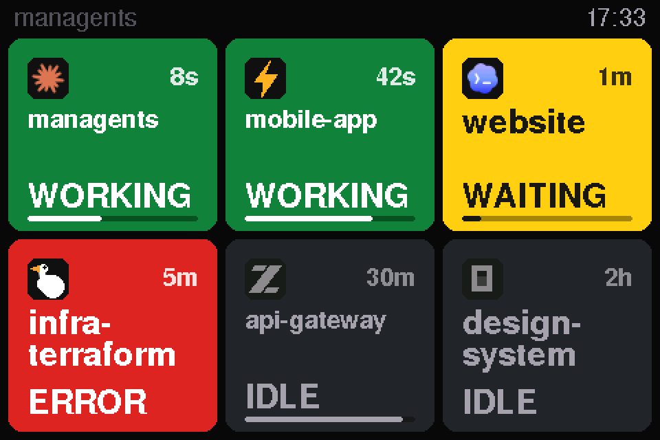
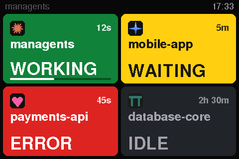
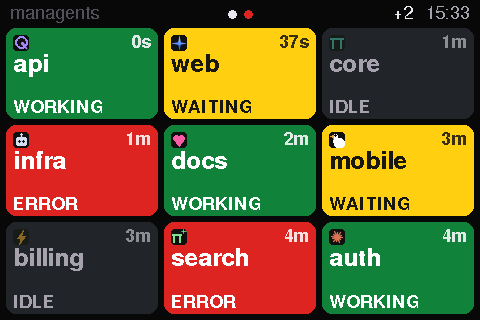
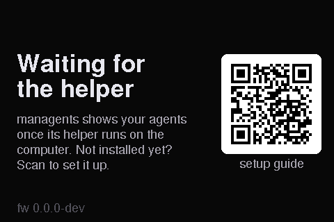
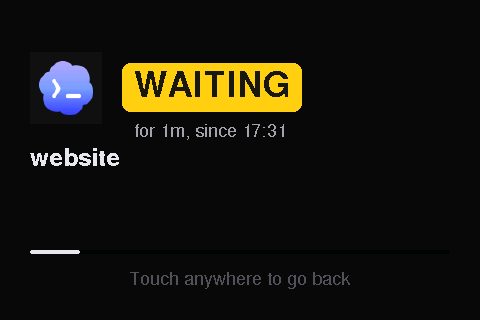
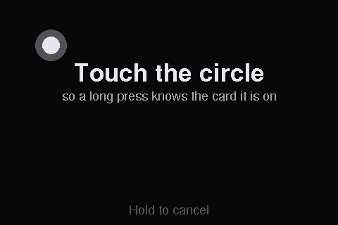

# Using the display

<p align="center">
  
</p>

<p align="center">
  
  
  
</p>
<p align="center"><sub>Rendered from the firmware's own drawing code (<code>make screens</code>), not mocked up.</sub></p>

<p align="center">
  
  
</p>

## The cards

| Card | Meaning | RGB LED |
|---|---|---|
| **WORKING** (green) | the agent is running a turn | green |
| **WAITING** (yellow) | it needs you: a permission prompt, a question, or a finished turn | orange |
| **ERROR** (red) | the last turn ended in an API or model error; blinks for the first minute | red, blinking the first minute |
| **IDLE** (dark) | open but untouched for more than 2 hours | off |

Each card has the agent's logo, the folder name, how long it has been in that state and, along its bottom edge, a bar
for how full the context window is. The agents you work with come first: working sessions, then the most recent
changes.

## The chime

If a speaker is mounted (see [the enclosure](../enclosure/README.md#customise)), the display can play a short chime
the moment a card starts needing you: **one tone** when an agent starts **waiting**, **two tones** when one hits an
**error** — tellable apart without looking at the screen. It plays once per change: an agent that stays waiting or
failed is silent until something new happens, and agents that merely work, finish idling away, or a page flip make
no sound. When several agents change in the same moment, it is one chime — an error wins over a waiting agent.

The chime is **off by default** and is turned on from the computer, not on the display:

```sh
managents sound on      # or: managents sound off
```

The display remembers the choice across reboots, so the command is only needed when it changes. A dimmed screen
stays quiet — nobody is at the desk to hear it — but still wakes, so the state is there when you are.

## Pages

Nine cards fit on a page. **Tap anywhere** to turn the page; it returns to the first after 30 seconds. The dots in the
header are coloured by what the other pages need: red when one holds an error, yellow when one has a waiting agent. A
`+N` badge counts sessions that do not fit.

When every agent has been idle (or there are none) for five minutes, the backlight dims; a tap wakes it.

## The detail view

**Hold a card for about half a second** (a long press) and it opens in full: the agent's logo, the folder name, the
status and how long it has been in it, the clock time that status started, and the context bar when the helper knows
the limit. The screen shows what the protocol already carries — nothing about the agent beyond what the cards are
made of. A tap, short or long, anywhere on the screen goes back to the grid; a plain tap never opens it.

The position of the long press needs the touch panel calibrated (see below); until it is, a long press offers the
calibration instead.

## The touch calibration

The resistive panel varies unit by unit, so hitting a card precisely needs a 15-second calibration. Nothing is asked
at boot: the display works fine without it, and plain taps page from the very first second. The first long press
simply shows the calibration — **touch the circle**, then the second one — and the display remembers it, so it is a
once-ever step. Hold any touch for a moment to cancel it, and hold a touch for a second and a half (on any screen)
to run it again later, say after the display moves to another board. If the two touches land too close together to
trust, the display quietly stays uncalibrated.

## The three status screens

They say what is going on with the computer:

- **Connecting**: right after power-up.
- **Setup needed**, with a QR code to the [setup steps](../README.md#get-started): the helper has not been heard from
  for 15 seconds, because it is not installed or not running.
- **Reconnecting**: the helper stopped talking, which usually means the computer went to sleep.

## About the LED

The RGB LED sits on the **back** of the board, behind the screen, so you do not see it from the front. It glows through
the back grille onto the wall behind the display (in the light case, onto the desk under it), or perhaps through a
white or translucent case (untested); do not
count on it as an indicator. The screen is the display.

## Where to put it

The panel is a TN panel and looks best from its left in this orientation, so put the display to the right of your line
of sight. See [hardware](hardware.md#placement).

Not what you expected? [Troubleshooting](troubleshooting.md).
