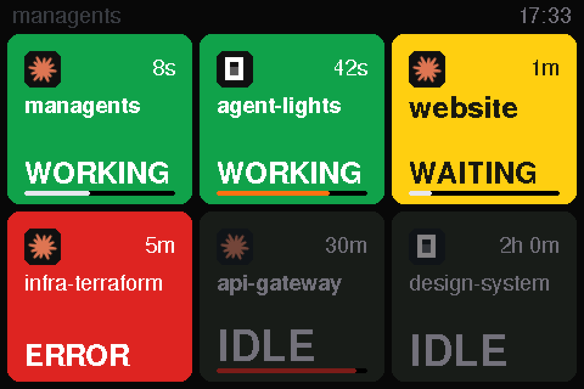
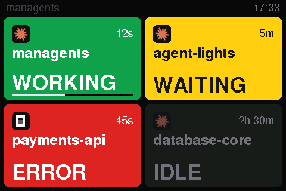
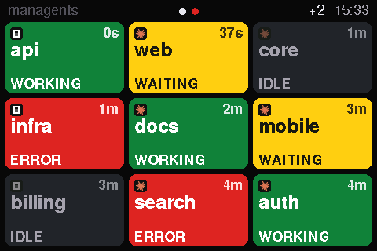
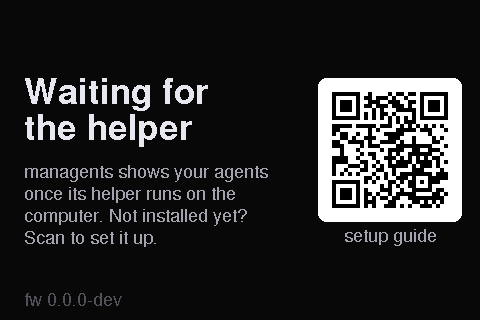

# Using the display

  

  
  
  

Rendered from the firmware's own drawing code (<code>make screens</code>), not mocked up.

## The cards

| Card | Meaning | RGB LED |
|---|---|---|
| **WORKING** (green) | the agent is running a turn | green |
| **WAITING** (yellow) | it needs you: a permission prompt, a question, or a finished turn | orange |
| **ERROR** (red) | the last turn ended in an API or model error; blinks for the first minute | red, blinking the first minute |
| **IDLE** (dark) | open but untouched for more than 2 hours | off |

Each card has the agent's logo, the folder name, how long it has been in that state and, along its bottom edge, a bar
for how full the context window is. The agents you work with come first: working sessions, then the most recent
changes.

## Pages

Nine cards fit on a page. **Tap anywhere** to turn the page; it returns to the first after 30 seconds. The dots in the
header are coloured by what the other pages need: red when one holds an error, yellow when one has a waiting agent. A
`+N` badge counts sessions that do not fit.

When every agent has been idle (or there are none) for five minutes, the backlight dims; a tap wakes it.

## The three status screens

They say what is going on with the computer:

- **Connecting**: right after power-up.
- **Setup needed**, with a QR code to the [setup steps](../README.md#get-started): the helper has not been heard from
  for 15 seconds, because it is not installed or not running.
- **Reconnecting**: the helper stopped talking, which usually means the computer went to sleep.

## About the LED

The RGB LED sits on the **back** of the board, behind the screen, so you do not see it from the front. It glows through
the back grille onto the wall behind the display (in the light case, onto the desk under it), or perhaps through a
white or translucent case (untested); do not
count on it as an indicator. The screen is the display.

## Where to put it

The panel is a TN panel and looks best from its left in this orientation, so put the display to the right of your line
of sight. See [hardware](hardware.md#placement).

Not what you expected? [Troubleshooting](troubleshooting.md).
