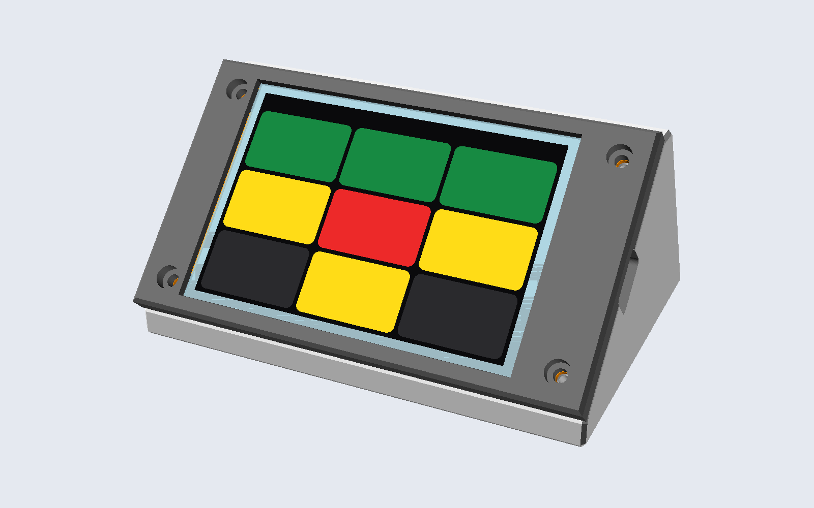
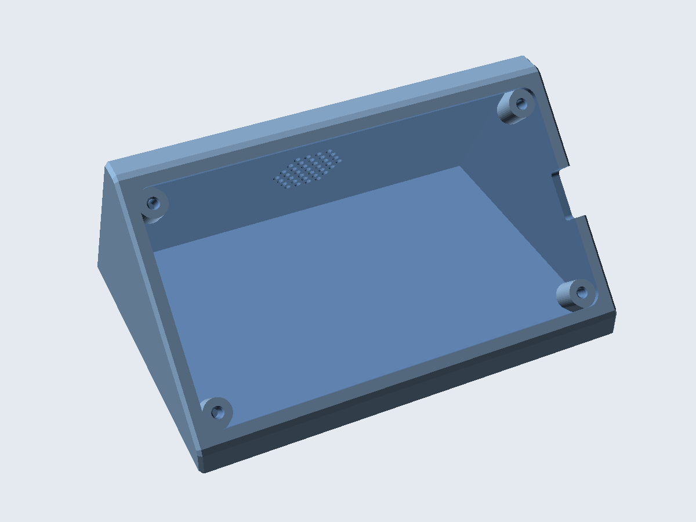
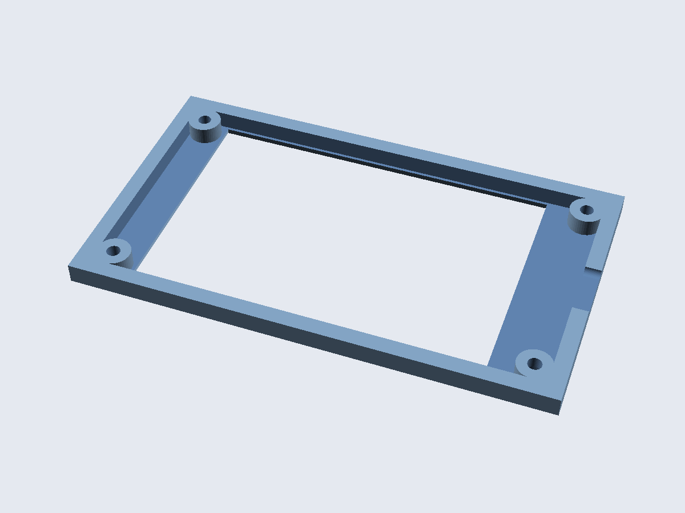
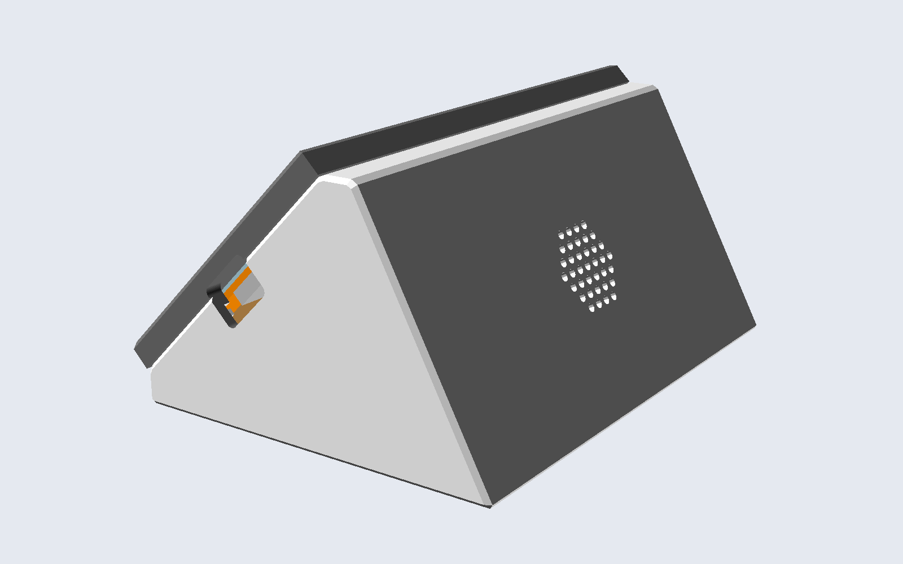

# managents enclosure

A desk wedge that holds the LCDWiki 4.0" ESP32-32E display (E32R40T) at **45°**, in landscape with the USB-C port
on the right. Two parts, no supports. Designed in OpenSCAD from the vendor's dimensioned drawing.

<p align="center">
  
</p>

| Body | Bezel (print orientation) | USB-C side and back |
|---|---|---|
|  |  |  |

Overall size: **120 × 88 × 57 mm** (w × d × h) plus the 6 mm bezel.

## Print

| Part | File | Orientation | Notes |
|---|---|---|---|
| Fit test | [`stl/managents-fit_test.stl`](stl/managents-fit_test.stl) | flat | **Print this first** (≈10 min). Lay the board face down on it: the four pins must pass through the mounting holes (Ø2.9 pins in Ø3.2 holes check the positions to ±0.15 mm). Lift the board and look through the window: it must frame the picture. |
| Body | [`stl/managents-body.stl`](stl/managents-body.stl) | standing on its base, as exported | Nothing overhangs more than 45° from vertical except short bridges: the ceiling under the top flat (5.5 mm), the four feet recesses and the 2 mm grille holes. The four Ø2.5 screw pilot holes print at 45° and need no supports. |
| Bezel | [`stl/managents-bezel.stl`](stl/managents-bezel.stl) | face down, as exported | The counterbore floors are short bridges. A textured PEI sheet gives a matte front. |

Suggested settings: PLA or PETG, 0.2 mm layers, 4 walls (the 2.4 mm walls then print solid), 15 % infill, no
supports.

**Filament.** The board's RGB LED is on the back of the PCB, facing into the case. In an opaque body you only see it
as a glow through the back grille onto whatever is behind the display. In white or natural (translucent) PETG some of
its light should come through the body; this is untested.

## Bill of materials

| Qty | Part |
|---|---|
| 1 | LCDWiki 4.0" ESP32-32E display, E32R40T (or E32N40T) |
| 4 | **ST2.9 × 9.5 self-tapping pan head screws**, DIN 7981 type C (ISO 7049), stainless or zinc, Phillips or Torx. A thread-forming Ø3.0 × 10 mm pan head screw for plastic also works. No inserts, no nuts. |
| 4 | Self-adhesive rubber feet, Ø10 mm, at least 2 mm thick: **required**, without them a tap slides the case |
| 1 | USB-C data cable (see [Cable](#cable)) |

## Assemble

1. Drop the board into the face, screen up, USB-C towards the side opening.
2. Put the bezel on and drive the four screws straight into the Ø2.5 pilot holes in the corner supports. They cut
   their own thread (4.9 mm of it in the plastic). Do it in two passes, a little at a time across the diagonals, and
   stop as soon as the head sits on the bezel: the thread in printed plastic strips if you keep turning. The bezel's
   corner posts press on the PCB's mounting pads only, never on the glass, so the resistive touch panel stays free.
3. Stick the rubber feet into the recesses under the base.

If a screw bites too hard because your printer makes small holes, run a 2.5 mm drill bit through the pilot hole by
hand first. The thread is plastic: the case survives a handful of re-assemblies, not hundreds.

Inside the closed case end up the **BOOT** and **RESET** buttons, which you never need (the USB bridge resets the
board and starts the download mode for flashing), the **microSD** slot (unused; leave it empty, it cannot be reached)
and the **RGB LED** (see Filament).

## Cable

The side opening is centred on the board's USB-C receptacle and fits plugs with overmolds up to about 13 × 8.5 mm,
which covers most cables. A right-angle plug keeps the cable flat on the desk.

## Stability

The feet sit at the corners of the base. By estimate (PLA, board included) a firm tap at the top of the screen tips
the case only above about 9 N, around ten times what a resistive touch needs; without the feet it slides at under 1 N.
Rendering the model echoes how far back the feet would have to reach for no tap to tip it.

## Customise

Everything is a parameter at the top of [`managents_case.scad`](managents_case.scad), also in OpenSCAD's Customizer:
`base_depth`, `lip_h`, wall thickness, clearances, screw and pilot hole sizes, `usb_cutout`, `chamfer`, the grille and
the speaker mount. `face_angle` is one too, but only 45° prints without supports; any other angle prints a warning.
Board dimensions are in [`lib/e32r40t.scad`](lib/e32r40t.scad), taken from the vendor drawing (see
[docs/hardware.md](../docs/hardware.md#mechanical-data)).

```bash
openscad managents_case.scad                          # interactive, part = "assembly"
openscad -D 'part="section"' managents_case.scad      # assembly cut in half: check clearances
make enclosure                                        # re-render all STLs (from the repo root)
make enclosure-check                                  # check that each printed part is one solid, as CI does
make enclosure-images                                 # re-render the images above
```

`make enclosure` and `make enclosure-check` work with the stable OpenSCAD (2021.01) and with snapshots, where they
use the faster Manifold backend. `make enclosure-images` needs a snapshot: 2021.01 lacks its colour scheme.

`speaker_mount` adds a ring for a 28 mm speaker behind the grille, for the roadmap's sound feature. It is off: its
underside needs supports, and the plug in the board's side-entry SPEAKER socket will need a relief in the face shell.

## Status

v1.2 is designed from the drawing and checked in renders and with geometry checks (one solid per part, overhangs,
plug and board clearances), not yet printed. Measured corrections go into `lib/e32r40t.scad`; planned improvements
are in the [roadmap](../docs/roadmap.md).
